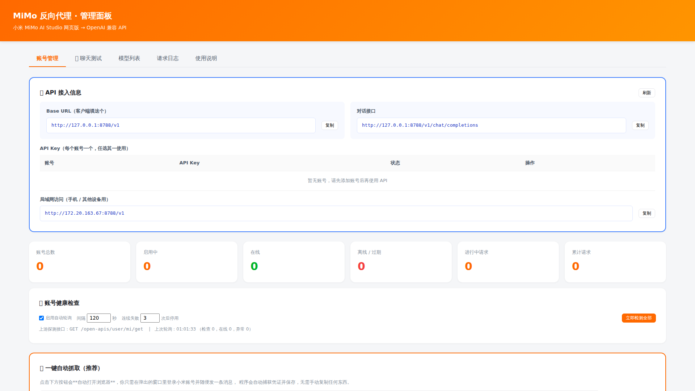
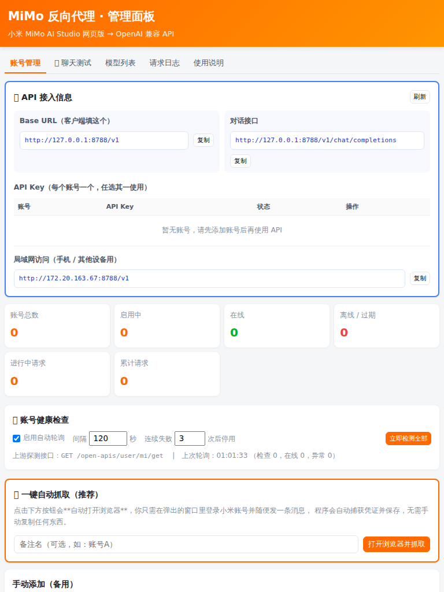
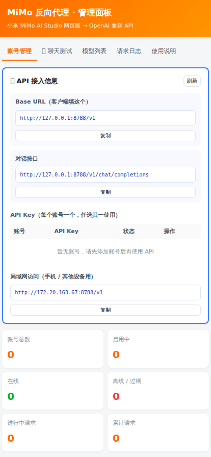

# MiMo 反向代理

把**小米 MiMo AI Studio 网页版**包装成本地 **OpenAI 兼容 API**，支持多账号登录与负载均衡。
可以在 Cursor、Continue、Open WebUI、ChatBox 等任意支持 OpenAI 协议的工具中直接使用。

[](https://nodejs.org)
[](LICENSE)
[](https://www.typescriptlang.org)

---

## 界面预览

桌面端（1920px）— 内容居中，API 信息与统计卡片自适应多列



平板（768px）— 自动降为 4 列统计、API 两列



手机（414px）— 单列堆叠，按钮全宽



---

## 特性

- ✅ **响应式界面**：百分比 + `clamp()` 流式布局，从手机到超宽屏自适应
- ✅ **一键自动抓取**：程序内调起浏览器，登录后自动捕获凭证，无需手动复制
- ✅ **账号自动入库**：抓到的凭证直接存入数据库，同账号自动更新不重复
- ✅ **健康检查轮询**：定时主动探测账号在线状态，连续失败自动停用
- ✅ **SQLite 持久化**：账号、日志、检查历史全部入库，重启不丢数据
- ✅ **API 信息面板**：面板直接显示 Base URL 与各账号 Key，一键复制
- ✅ **内置聊天测试**：面板里直接试对话，实时查看思考链与 token 消耗
- ✅ **OpenAI 兼容**：`/v1/models`、`/v1/chat/completions`（流式 + 非流式）
- ✅ **多账号 + 负载均衡**：自动选择最空闲账号，支持并发控制
- ✅ **小米账号登录**：自动抓取或手动粘贴 cURL 两种方式
- ✅ **模型型号实时抓取**：直接读上游 `bot/config`，含别名跳转解析
- ✅ **思考链三种模式**：`separate` / `passthrough` / `strip`
- ✅ **会话保持**：消息指纹匹配，复用 conversationId，节省 token
- ✅ **凭证过期自动提示**：捕获上游 `loginUrl`，面板一键跳转重新登录
- ✅ **管理面板**：账号增删、模型列表、请求日志、统计
- ✅ **零原生依赖**：纯 Node.js，不需要编译，Windows 开箱即用

---

## 快速开始

### 1. 安装依赖

```bash
npm install
```

### 2. 构建并启动

```bash
npm run build
npm start
```

开发模式（免构建，直接跑 TS）：

```bash
node --experimental-strip-types src/index.ts
```

启动后：

- API 地址：`http://127.0.0.1:8788/v1`
- 管理面板：`http://127.0.0.1:8788/admin`

### 3. 添加小米账号

#### 方式一：一键自动抓取（推荐）

打开管理面板 <http://127.0.0.1:8788/admin>，点击 **「打开浏览器并抓取」**，然后：

1. 程序会**自动弹出一个浏览器窗口**
2. 在窗口里**登录你的小米账号**
3. 进入对话页，**随便发一条消息**（这一步用于触发凭证捕获）
4. 凭证被自动抓取并保存，面板会显示生成的 **API Key**

全程无需手动复制任何东西。

> **原理**：程序不逆向 token 生成算法（那样容易随上游更新失效），
> 而是启动真实浏览器，**拦截页面自己发出的 `chat` 请求**，
> 从中直接提取真实的 `serviceToken` / `userId` / `ph_token`。
> 这种方式与上游前端行为完全一致，最稳定。

**多个账号**：重复以上步骤即可（建议先在浏览器里退出登录再登录另一个账号）。
每个账号会得到独立的 API Key，请求会自动在账号间轮询。

#### 方式二：手动粘贴 cURL（备用）

1. 浏览器打开 <https://aistudio.xiaomimimo.com>，**登录小米账号**
2. 进入对话页，按 `F12` → **Network** 面板
3. 随便发一条消息，找到 `chat` 请求
4. 右键 → **Copy as cURL**
5. 打开管理面板 → 粘贴到「手动添加」输入框 → 点「添加账号」

> ⚠️ **Chrome 130+ 重要提示**
> 新版 Chrome 在 "Copy as cURL" 时**默认剥离 Cookie**，会导致导入失败。
> 请先在 DevTools → **设置(⚙️)** → **Preferences** 中勾选
> **「Allow to generate HAR with sensitive data」**，再重新复制。
> 若嫌麻烦，直接用方式一。

#### 浏览器要求

自动抓取需要本机安装 **Chrome** 或 **Edge**。程序会自动检测以下位置：

- `C:\Program Files\Google\Chrome\Application\chrome.exe`
- `C:\Program Files (x86)\Google\Chrome\Application\chrome.exe`
- `%LOCALAPPDATA%\Google\Chrome\Application\chrome.exe`
- `C:\Program Files\Microsoft\Edge\Application\msedge.exe`
- Playwright 自带 Chromium（若已安装）

也可用环境变量 `MIMO_BROWSER_PATH` 显式指定浏览器路径。

### 4. 获取 API 地址与 Key

打开管理面板 <http://127.0.0.1:8788/admin>，页面**最上方**就是「🔌 API 接入信息」：

- **Base URL** —— 客户端要填的地址（如 `http://127.0.0.1:8788/v1`）
- **对话接口** —— 完整 endpoint
- **API Key 列表** —— 每个账号一个 Key，**点击即可复制**
- **局域网地址** —— 若需手机/其他设备接入，用这里的地址

另外，**服务启动时控制台也会打印所有账号的 API Key**，方便直接复制：

```
  ── 账号 API Key ──────────────────────────────────────
  ✅ 我的账号
     sk-mimo-1a2b3c4d5e6f7g8h9i0j...
  ──────────────────────────────────────────────────────
```

### 5. 测试对话

管理面板 → **「💬 聊天测试」** 标签页，可以直接发消息验证：

- 上方选择要使用的**账号**和**模型**
- 可切换 **流式 / 非流式**
- 勾选 **思考链** 开启推理，**显示思考过程** 控制是否展示 🧠 思考块（点击可折叠）
- 底部实时显示 **耗时、prompt/completion/reasoning token 数**

在「API 接入信息」里点某个 Key 的 **「测试」** 按钮，会直接跳到聊天页并选中该账号。

### 6. 接入客户端

```bash
curl -N http://127.0.0.1:8788/v1/chat/completions \
  -H "Content-Type: application/json" \
  -H "Authorization: Bearer <你的APIKey>" \
  -d '{
    "model": "mimo-v2.6-pro",
    "messages": [{"role":"user","content":"你好"}],
    "stream": true
  }'
```

---

## 客户端配置

| 工具 | 配置 |
|---|---|
| **Cursor** | Settings → Models → OpenAI API Base: `http://127.0.0.1:8788/v1` |
| **Continue** | config.json → `apiBase: "http://127.0.0.1:8788/v1"` |
| **Open WebUI** | 设置 → 连接 → API Base URL: `http://127.0.0.1:8788/v1` |
| **ChatBox** | 设置 → API 域名: `http://127.0.0.1:8788` |
| **Python** | `OpenAI(base_url="http://127.0.0.1:8788/v1", api_key="你的Key")` |
| **Node.js** | `new OpenAI({ baseURL: "http://127.0.0.1:8788/v1", apiKey: "你的Key" })` |

---

## 可用模型

模型列表**实时从上游抓取**，调用 `/v1/models` 可查看当前全部型号。

截至 2026-10-15 实测的 chat 类模型：

| 模型 ID | 名称 | 说明 |
|---|---|---|
| `mimo-v2.6-pro` | MiMo-V2.6-Pro | 最新主力，1T 参数，1M 上下文 |
| `mimo-v2.6-flash` | MiMo-V2.6-Flash | 最新轻量，300B 参数，1M 上下文 |
| `mimo-v2-pro` | MiMo-V2-Pro | 已废弃 → 自动跳转 `mimo-v2.6-pro` |
| `mimo-v2-flash` | MiMo-V2-Flash | 已废弃 → 自动跳转 `mimo-v2.6-flash` |
| `mimo-v2-omni` | MiMo-V2-Omni | 已废弃 → 跳转 `mimo-v2.6-flash` |
| `mimo-v2.5` | MiMo-V2.5 | 已废弃 → 跳转 `mimo-v2.6-flash` |
| `mimo-v2.5-pro` | MiMo-V2.5-Pro | 已废弃 → 跳转 `mimo-v2.6-pro` |
| `mimo-v2.1-pro` | MiMo-V2.1-Pro | 已废弃 → 跳转 `mimo-v2.6-pro` |
| `mimo-v2.1-omni` | MiMo-V2.1-Omni | 已废弃 → 跳转 `mimo-v2.6-flash` |
| `mimo-v2.1-pro-preview` | MiMo-V2.1-Pro | 预览版 |
| `mimo-v2.1-omni-preview` | MiMo-V2.1-Omni | 预览版 |
| `mimo-v2-flash-studio` | MiMo-V2-Flash | Studio 入口 |
| `clawl-alpha` | MiMo-V2-Pro | 内测别名 |
| `clawm-alpha` | MiMo-V2-Omni | 内测别名 |

> **关于「已废弃」**：带 `redirectTo` 的型号在上游会被自动转发到新模型。
> 本代理会在转发前解析该字段，保证行为可预期。

---

## 思考链（Thinking）

MiMo 把推理过程**内联在正文中**（`<think>推理</think>答案`），
本代理用状态机正确拆分，即使标签被 SSE 流分片切断也能处理。

### 三种模式

| 模式 | 行为 | 适用场景 |
|---|---|---|
| `separate`（默认） | 推理放入 `reasoning_content` 字段 | 支持思维链展示的客户端 |
| `passthrough` | 原样保留 `<think>` 标签 | 需要原始输出 |
| `strip` | 移除推理，只留答案 | 不关心思考过程 |

配置方式：

```bash
# 环境变量（全局）
MIMO_THINK_MODE=separate npm start
```

```json
// 单次请求（过滤思考链）
{ "strip_reasoning": true, "messages": [...] }
```

```http
x-strip-reasoning: true
```

---

## 界面自适应

管理面板使用**百分比 + 流式布局**，从手机到超宽屏都能正常显示。

### 实现方式

| 技术 | 用途 |
|---|---|
| `width: 96%` + `max-width` | 容器按视口百分比填充，超宽屏有上限 |
| `clamp(最小, 视口相对, 最大)` | 字号、间距、圆角随视口平滑缩放 |
| `grid-template-columns: repeat(auto-fit, minmax(min(300px,100%), 1fr))` | 栅格列数随宽度自动增减 |
| `.table-wrap { overflow-x: auto }` | 表格在窄屏可横向滚动，不撑破布局 |
| `@media` 断点 | 针对特定尺寸微调 |

### 响应式断点

| 断点 | 适配目标 | 主要调整 |
|---|---|---|
| `max-width: 1024px` | 平板 / 小笔记本 | 容器 97%，消息气泡加宽 |
| `max-width: 768px` | 竖屏平板 | 容器 98%，表格紧凑，聊天区降低 |
| `max-width: 560px` | 手机 | 统计 2 列，API 单列，按钮全宽，隐藏头像 |
| `min-width: 1920px` | 桌面大屏 | 容器上限 1760px |
| `min-width: 2560px` | 超宽屏 | 容器上限 2100px，基准字号 16px |
| `max-height: 700px` | 矮屏（分屏） | 压缩聊天区与思考块高度 |
| `print` | 打印 | 隐藏交互元素 |
| `prefers-reduced-motion` | 无障碍 | 关闭动画 |

### 实测结果

| 视口 | 容器宽度 | 统计列数 | 横向溢出 |
|---|---|---|---|
| 360×740（手机） | 353px | 2 列 | 无 |
| 414×896（手机） | 406px | 2 列 | 无 |
| 768×1024（平板） | 753px | 4 列 | 无 |
| 1366×768（笔记本） | 1311px | 8 列 | 无 |
| 1920×1080（桌面） | 1760px | 10 列 | 无 |
| 2560×1440（超宽） | 2100px | 12 列 | 无 |

验证脚本：

```bash
node scripts/verify-responsive-render.mjs
```

它会用 Chromium 在各视口下渲染面板、检测横向溢出并截图到 `data/shots/`。

---

## 数据存储

使用 **SQLite**（Node 24 内置的 `node:sqlite`），数据库文件位于 `data/mimo.db`。

> **为什么不用 better-sqlite3？**
> 那是原生模块，需要编译，Windows 上经常失败（参考项目 mimo2api 的 README 里专门有一节讲这个坑）。
> Node 24 内置的 `node:sqlite` 提供同样的 `DatabaseSync` API，**零编译、开箱即用**。

### 表结构

| 表 | 用途 | 关键字段 |
|---|---|---|
| `accounts` | 账号与 API Key | `id`, `service_token`, `ph_token`, `api_key`, `is_active`, `health_status`, `consecutive_failures`, `source` |
| `logs` | 请求日志 | `time`, `account_id`, `model`, `status`, `duration_ms`, `total_tokens` |
| `health_checks` | 健康检查历史 | `account_id`, `time`, `ok`, `latency_ms`, `status`, `error` |
| `settings` | 键值配置 | `key`, `value` |

已建立索引：`api_key`、`is_active`、`logs.time`、`health_checks(account_id, time)`。
启用了 **WAL 模式**，读写并发更友好。

---

## 账号健康检查

代理会**定时主动探测**每个账号是否仍然可用，避免「请求时才发现凭证过期」。

### 探测方式

```
GET https://aistudio.xiaomimimo.com/open-apis/user/mi/get
```

该接口返回当前登录用户信息，能直接反映 `serviceToken` 是否有效。

### 状态含义

| 状态 | 含义 |
|---|---|
| 🟢 在线 | 凭证有效，正常可用 |
| 🔴 离线 | 网络错误或上游异常 |
| 🟠 已过期 | 凭证失效，需要重新登录 |
| ⚪ 未检测 | 尚未检查过 |

### 自动停用

连续失败达到阈值（默认 3 次）时，账号会**自动停用**，避免持续拖慢请求。
重新添加账号或手动启用即可恢复，连续失败计数会归零。

### 配置

面板「🩺 账号健康检查」区域可直接调整：

| 配置项 | 默认值 | 说明 |
|---|---|---|
| 启用自动轮询 | 开 | 关闭后只能手动检测 |
| 轮询间隔 | 300 秒 | 最短 30 秒 |
| 连续失败阈值 | 3 次 | 设为 0 表示不自动停用 |
| 请求超时 | 15000 ms | 单次探测超时 |

也可以直接调用 API：

```bash
# 查看配置与状态
curl http://127.0.0.1:8788/admin/health

# 立即检测全部账号
curl -X POST http://127.0.0.1:8788/admin/health/check \
  -H 'Content-Type: application/json' -d '{}'

# 只检测指定账号
curl -X POST http://127.0.0.1:8788/admin/health/check \
  -H 'Content-Type: application/json' \
  -d '{"ids":["账号ID"]}'

# 查看某账号的检查历史
curl http://127.0.0.1:8788/admin/health/<账号ID>

# 修改配置
curl -X PATCH http://127.0.0.1:8788/admin/health/config \
  -H 'Content-Type: application/json' \
  -d '{"intervalSec":120,"autoDisableAfter":5}'
```

### 检查历史

每次检查都会写入 `health_checks` 表，面板点账号行的「历史」按钮可查看最近 30 次记录
（时间、结果、延迟、错误原因）。

> 历史记录默认保留 7 天，超期自动清理。

### 用 SQL 直接查询

```bash
# 需要 sqlite3 命令行工具，或用 Node 查询
node -e "
const {DatabaseSync}=require('node:sqlite');
const db=new DatabaseSync('data/mimo.db');
console.log(db.prepare('SELECT alias,api_key,request_count FROM accounts').all());
db.close();
"
```

### 备份与重置

```bash
# 备份（先停服务）
cp data/mimo.db data/mimo-backup.db

# 重置全部数据
rm -f data/mimo.db data/mimo.db-shm data/mimo.db-wal
```

---

## 环境变量

| 变量 | 默认值 | 说明 |
|---|---|---|
| `PORT` | `8788` | 监听端口 |
| `HOST` | `0.0.0.0` | 监听地址 |
| `MIMO_PROXY` | 空 | 上游代理，如 `http://127.0.0.1:7890` |
| `MIMO_BROWSER_PATH` | 自动检测 | 自动抓取所用的浏览器可执行文件路径 |
| `MIMO_THINK_MODE` | `separate` | 思考链模式 |
| `MIMO_SESSION_ISOLATION` | `auto` | 会话隔离：`auto` / `manual` / `per-request` |
| `MIMO_MAX_CONCURRENT` | `4` | 单账号最大并发 |
| `MIMO_CONTEXT_RESET_TOKENS` | `150000` | 超此 token 数重置会话 |
| `MIMO_SESSION_TTL_HOURS` | `24` | 会话保留时长 |

---

## 管理 API

| 方法 | 路径 | 说明 |
|---|---|---|
| `GET` | `/health` | 健康检查 |
| `GET` | `/admin/accounts` | 账号列表 + 统计 |
| `POST` | `/admin/accounts` | 添加账号（`{curl}` 或 `{serviceToken,userId,phToken}`） |
| `PATCH` | `/admin/accounts/:id` | 修改备注 / 启停 |
| `DELETE` | `/admin/accounts/:id` | 删除账号 |
| `POST` | `/admin/parse` | 仅解析 cURL，不保存 |
| `POST` | `/admin/capture/start` | **启动浏览器自动抓取** |
| `GET` | `/admin/capture/status?id=` | 查询抓取状态（前端轮询） |
| `POST` | `/admin/capture/save` | 把抓到的凭证存入数据库（同账号自动更新） |
| `POST` | `/admin/capture/cancel` | 关闭抓取浏览器 |
| `GET` | `/admin/health` | 健康检查配置 + 状态 + 汇总 |
| `POST` | `/admin/health/check` | 立即执行检查（可指定 ids） |
| `GET` | `/admin/health/:id` | 某账号的检查历史 |
| `PATCH` | `/admin/health/config` | 修改轮询配置 |
| `GET` | `/admin/api-info` | **API 地址 + 各账号 Key**（面板顶部数据来源） |
| `GET` | `/admin/stats/daily` | 按天统计（图表用） |
| `GET` | `/admin/models` | 实时抓取上游模型 |
| `GET` | `/admin/logs` | 请求日志（分页） |
| `DELETE` | `/admin/logs` | 清空日志 |
| `GET` | `/admin/config` | 当前配置（含浏览器路径检测结果） |

---

## 项目结构

```
├── src/
│   ├── index.ts            # HTTP 服务 + OpenAI 兼容路由 + 管理 API
│   ├── db.ts               # SQLite 初始化、表结构与列迁移（node:sqlite）
│   ├── accounts.ts         # 多账号管理、负载均衡、健康状态、cURL 解析
│   ├── health.ts           # 账号健康检查轮询
│   ├── capture.ts          # 浏览器自动抓取凭证（Playwright）
│   ├── logger.ts           # 请求日志（SQLite 持久化 + 聚合统计）
│   └── mimo/
│       ├── client.ts       # MiMo 上游客户端（模型抓取 + SSE 流）
│       ├── serialize.ts    # 消息序列化 + 思考链状态机
│       └── session.ts      # 会话保持（消息指纹匹配）
├── public/
│   └── index.html          # 管理面板（账号/聊天测试/模型/日志/说明）
├── test/
│   ├── think-parser.test.ts       # 思考链解析测试（22 项）
│   └── parse-credential.test.ts   # 凭证解析测试（16 项）
├── docs/
│   └── 协议逆向报告.md      # 上游协议分析
└── data/
    └── mimo.db             # SQLite 数据库（自动生成，已 gitignore）
```

---

## 测试

```bash
node --experimental-strip-types test/think-parser.test.ts
node --experimental-strip-types test/parse-credential.test.ts
```

---

## 常见问题

**Q: 点击「打开浏览器并抓取」后没反应？**

检查是否安装了 Chrome 或 Edge。可在 `GET /admin/config` 的 `browserPath` 字段查看检测结果。
若显示为 `null`，请安装 Chrome，或用环境变量指定：

```bash
MIMO_BROWSER_PATH="C:\路径\chrome.exe" npm start
```

**Q: 浏览器打开了，但一直提示「等待登录」？**

凭证是在页面**发送消息**时才会被抓取。请务必在浏览器窗口里：
① 完成登录 → ② 进入对话页 → ③ **实际发送一条消息**。

**Q: 添加账号提示「未找到 Cookie」？**

这是手动方式的问题。Chrome 130+ 在 Copy as cURL 时会剥离 Cookie。
请在 DevTools → 设置(⚙️) → Preferences 中勾选
「Allow to generate HAR with sensitive data」后重新复制。**或直接用一键自动抓取。**

**Q: 提示「没有可用账号」？**

所有账号都被停用，或都达到了并发上限。到管理面板检查账号状态，
或调大 `MIMO_MAX_CONCURRENT`。

**Q: 账号自动变成「停用」？**

说明上游返回了 401/403（凭证过期或账号异常），代理会自动禁用它以免影响其他账号。
重新登录小米账号并更新凭证即可。

**Q: 返回内容只有答案，没有思考过程？**

思考链模式为 `strip`。改成 `separate` 或 `passthrough`。

**Q: 连接上游失败？**

检查是否设置了系统代理。本代理**默认直连**，如需代理请显式设置 `MIMO_PROXY`。
注意：如果系统 `HTTP_PROXY` 指向一个未运行的代理，其他工具可能受影响，
但本代理不受干扰。

---

## 免责声明

本项目仅供个人学习研究使用，与小米公司无任何关联。

使用者需自行遵守 [MiMo 服务条款](https://aistudio.xiaomimimo.com)。
滥用（商业牟利、大规模并发、DDoS 等）可能导致账号受限，风险自负。

## License

MIT
